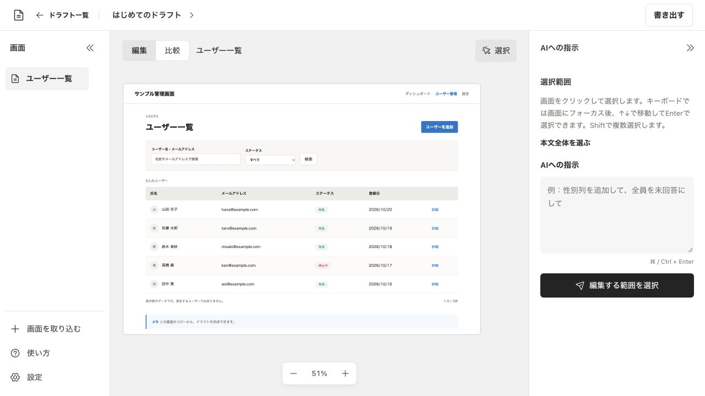

# ScreenDraft

Chromeで表示しているWeb画面を取り込み、変更案を検討するMacアプリです。関連する画面を一つのドラフトにまとめられます。画面の編集はAIに指示できます。保存した履歴は現在の画面と並べて比較できます。

## できること

- Chromeで表示中の画面を取り込む
- 画面の範囲を選び、Claude Codeへ編集を依頼する
- 変更後の画面と過去の履歴を並べて比較する
- 比較画像と説明をZIPで書き出す
- ドラフトと履歴をScreenDraft形式で保存し、別の環境へ読み込む

## 動作環境

Apple Silicon搭載のMacとGoogle Chromeが必要です。macOSの対応バージョンは別のMacでの検証後に案内します。Intel MacとWindowsは未検証です。

画面の取り込み、保存、履歴比較にはClaude Codeは必要ありません。AI編集には利用者自身がインストール・認証した[Claude Code](https://code.claude.com/docs/ja/setup)が必要です。ScreenDraftはインストール済みのClaude Codeを起動します。利用条件は[Claude Codeの公式ガイド](https://code.claude.com/docs/en/legal-and-compliance)を確認してください。AIの利用料は利用者自身の契約に従います。

## インストール

GitHubの[Releases](https://github.com/NaokiOouchi/ScreenDraft/releases)からApple Silicon向けDMGをダウンロードしてください。

1. DMGを開き、ScreenDraftを「アプリケーション」へコピーします。
2. ScreenDraftを起動し、メニューの「Chrome拡張フォルダを開く」を選択します。
3. Chromeで`chrome://extensions`を開き、デベロッパーモードを有効にします。「パッケージ化されていない拡張機能を読み込む」から、開いたフォルダを指定します。
4. ScreenDraftの設定で「Chrome拡張」を選択し、接続先と接続キーを確認します。
5. 取り込みたい画面をChromeで開き、ScreenDraft拡張に接続先とキーを入力します。ドラフトを選択して画面を取得します。

詳しい操作はアプリ内の「使い方」で確認できます。

## データについて

取り込んだ画面と履歴はMac内に保存します。AI編集では選択範囲のDOM・スタイル・指示をClaude Code経由で送信します。画面の取得時には取り込み元や画像・フォントの配信元と通信します。

比較画像やScreenDraft形式のファイルには画面に表示されていた内容が含まれます。共有前に内容を確認してください。保存先の確認やバックアップの手順はアプリ内の「使い方」にあります。

## 開発

ソースからの起動方法とテスト手順は[開発ガイド](CONTRIBUTING.md)を参照してください。

## ライセンス

ScreenDraftの独自コードは[GNU Affero General Public License v3.0のみ](LICENSE)で提供します。第三者のソフトウェア・素材にはそれぞれのライセンスが適用されます。依存ライブラリの告知は[THIRD_PARTY_NOTICES.txt](THIRD_PARTY_NOTICES.txt)を参照してください。

## 問い合わせ

不具合や機能の要望は[GitHub Issues](https://github.com/NaokiOouchi/ScreenDraft/issues)で受け付けます。投稿は公開されます。取り込んだ画面や接続キーなどの非公開情報は含めないでください。脆弱性の報告方法は[セキュリティポリシー](SECURITY.md)を参照してください。
